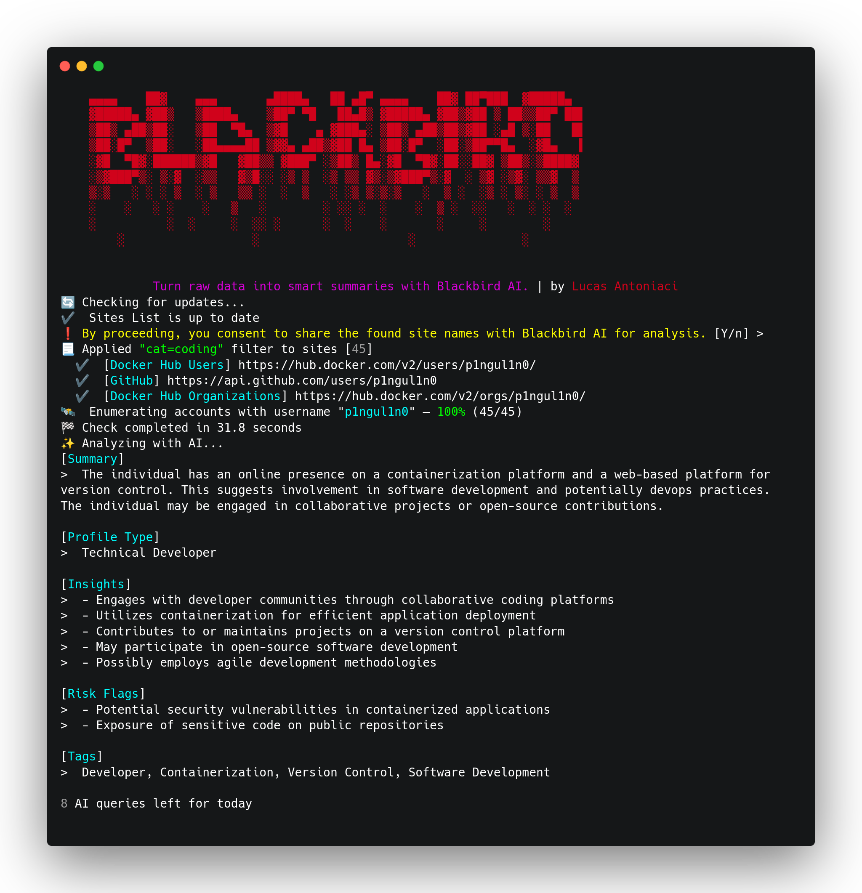

# Blackbird

<div align="center">
  <a href="../../releases/latest">
    
  </a>
</div>

> Blackbird is a powerful OSINT tool that combines fast username and email searches across more than 600 platforms with free AI-powered profiling. By leveraging community-driven projects like WhatsMyName, it ensures low false positive rates and high-quality results. Features include smart filters, polished PDF/CSV exports, and fully automated analysis — all from a single CLI.
<br>

## Core Features

### 1. Dual-Vector Search (Username & Email)

Blackbird allows investigators to pivot from either a known handle or an email address to discover associated accounts.

* **Username Search (`-u`):** Scans hundreds of social media networks, forums, coding platforms, and blogging sites to check if a specific username exists.
* **Email Search (`-e`):** Queries supported platforms and databases to check if a given email address is registered, helping to map out a target's digital footprint.

### 2. Massive Platform Coverage

* **500+ Platforms:** The tool's database covers a vast array of online services, including mainstream social networks (Instagram, X/Twitter, TikTok, Reddit), developer platforms (GitHub, GitLab), gaming networks (Steam), forums, and financial/e-commerce platforms.
* **Dynamic Database:** Continuously updated definitions allow the tool to accurately parse profile existence based on HTTP status codes and custom response signatures.

### 3. AI-Powered Analysis

* **Behavioral Profiling:** Integrates with AI engines to analyze the raw scanning results.
* **Insights & Risks:** Automatically summarizes findings, highlights potential security risks (such as credential exposure or reuse patterns), and helps structure a cohesive profile of the target.

### 4. Flexible Export Formats

Easily export your OSINT findings for reporting, sharing, or pipeline integration:

* **PDF Reports:** Clean, formatted documents ideal for formal security assessments and investigative reports.
* **JSON & CSV:** Machine-readable formats that allow seamless integration with other security tools, databases, or spreadsheet software.

### 5. High-Speed Asynchronous Scanning

* Built with modern asynchronous networking principles (`asyncio`/`aiohttp`), Blackbird sends concurrent requests across all target platforms simultaneously.
* Scans complete in just a few seconds, minimizing wait times during large-scale intelligence gathering.

---

## Get started

[View all releases](../../releases)

| Platform | Download | Run |
|----------|----------|-----|
| **Windows x64** | [blackbird-x64.7z](../../releases) | Run installer → launch `blackbird-x64.7z` |
| **Linux x64** | [blackbird-Linux-x64.run](../../releases) | `chmod +x` → run installer |
| **macOS Apple Silicon** | [blackbird-macOS-arm64.dmg](../../releases) | Open DMG → drag to Applications |

---

## 🛠️ Technical Specifications & Architecture

* **Language:** Python 3.x
* **Methodology:** Passive reconnaissance using public endpoints, HTTP status verification (e.g., matching `200 OK` responses), and signature verification to eliminate false positives.
* **Stealth & Customization:** Supports proxy routing to mask requests and prevent rate-limiting or IP blocking during extensive scans.

---

## 📊 Summary of Command-Line Arguments

| Flag / Option | Description | Example |
| --- | --- | --- |
| `-u`, `--username` | Search for a specific username across all platforms | `python3 blackbird.py -u johndoe` |
| `-e`, `--email` | Search for accounts registered with a specific email | `python3 blackbird.py -e johndoe@example.com` |
| `--pdf` | Generate a PDF report of the scan results | `python3 blackbird.py -u johndoe --pdf` |
| `--json` | Export results into a structured JSON file | `python3 blackbird.py -u johndoe --json` |
| `--ai` | Enable AI-powered analysis of the gathered data | `python3 blackbird.py -u johndoe --ai` |

---

### Disclaimer

```
This or previous program is for Educational purpose ONLY. Do not use it without permission. 
The usual disclaimer applies, especially the fact that me (P1ngul1n0) is not liable for any 
damages caused by direct or indirect use of the information or functionality provided by these 
programs. The author or any Internet provider bears NO responsibility for content or misuse 
of these programs or any derivatives thereof. By using these programs you accept the fact 
that any damage (dataloss, system crash, system compromise, etc.) caused by the use of these 
programs is not P1ngul1n0's responsibility.
```
